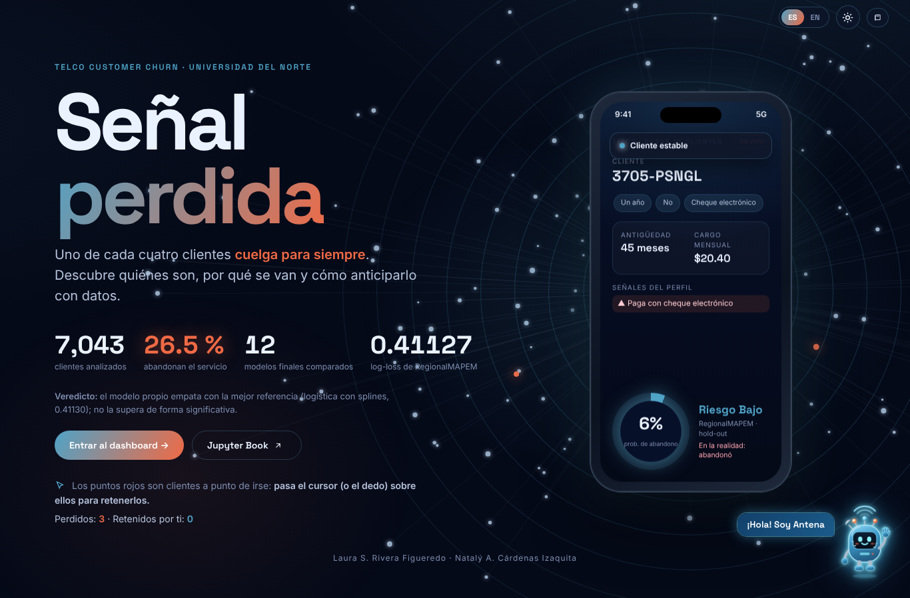

# Señal perdida · Dashboard Telco Customer Churn (Shiny)

Dashboard predictivo en **R Shiny y Plotly** para el proyecto de abandono de clientes de **Laura S. Rivera Figueredo y Natalý A. Cárdenas Izaquita** (Universidad del Norte). Es la versión en R del dashboard [Dash_Telco_Churn_ML](https://github.com/lauraformore/Dash_Telco_Churn_ML): mismas secciones, gráficas, textos, colores, animaciones, asistente e idiomas, y los mismos **12 modelos finales del entregable 4** (11 benchmarks calibrados y el modelo propio, RegionalMAPEM) para predecir en vivo. Todo el código de la aplicación es R.



- Jupyter Book: https://nataly-cardenas.github.io/Telco_Churn_JBook/ (capítulo 8: dashboard y despliegue)
- Experimento y resultados: https://github.com/Nataly-Cardenas/Telco_Churn_JBook
- Versión en Python (Dash): https://github.com/lauraformore/Dash_Telco_Churn_ML

## Secciones

| Ruta | Página | Contenido |
|---|---|---|
| `#contexto` | Contexto | Portada interactiva, problema con cifra citada, pregunta de investigación, objetivos, ficha y diccionario de los datos, diagrama de la metodología, marco teórico, limitaciones, ética, autoras y versión |
| `#eda` | EDA | Filtros globales (partición, contrato, internet, antigüedad) y 9 pestañas: ETL y partición, univariado, bivariado con pruebas y Holm, explorador bivariado (ejes y color a elección), multivariado, faltantes, resumen, preparación de datos y explorador con descarga CSV |
| `#modelos` | Modelos | Tabla de líderes ordenable y filtrable, predicción en vivo con probabilidad, conjunto conforme al 90 % y SHAP local, diagnóstico (confusión, calibración, ROC, precisión-recall), SHAP global, diagrama de diferencia crítica y 223 contrastes con Holm, modelo original (veredicto, pseudocódigo, convergencia, pruebas, robustez y pesos por región), ficha del modelo y los resultados de los entregables 2 y 3 (112 configuraciones, calibración, optimizadores, multifidelidad, eficiencia, comparación estadística, interpretabilidad, umbral y conclusiones) |

Las secciones usan fragmentos de URL, así que admiten enlaces directos y los botones de atrás/adelante del navegador.

## Ejecutar

Requiere R 4.1 o superior.

```r
source("install.R")   # una sola vez
shiny::runApp()
```

Desde una terminal: `Rscript -e "shiny::runApp(port = 8050, launch.browser = TRUE)"`. Para publicar en shinyapps.io: `rsconnect::deployApp()`.

## Modelos en R

Los 12 artefactos del dash (`modelo.joblib` de scikit-learn, XGBoost, LightGBM y CatBoost) se convirtieron una sola vez a `artifacts/<modelo>/modelo.rds` con sus parámetros ajustados: escalado y one-hot, coeficientes, árboles, vectores de soporte, B-splines, calibradores de Platt y, para RegionalMAPEM, los cuantiles, la PCA, el GMM de regiones y los pesos por región. `src/modelos.R` reimplementa en R la inferencia de cada modelo tal como la hace su librería original (incluida la comparación en precisión simple de los árboles), así que **las probabilidades coinciden con las del experimento** (diferencia máxima < 1e-7 en los 40 clientes de `artifacts/prueba_ida_y_vuelta.csv` y en el hold-out; lo comprueba `tests/testthat/test-modelos.R`). Los `metadata.json` de cada modelo se copian sin cambios y alimentan el formulario y la ficha.

- `scripts/convertir_artefactos.R` arma los `.rds` a partir de los parámetros exportados en JSON.
- La explicación local usa **Kernel SHAP** implementado en R con los mismos 12 clientes de referencia y 100 coaliciones del dash; los valores suman exactamente `p(x) − E[p(fondo)]`. Como el muestreo de coaliciones es aleatorio, pueden diferir ligeramente de los del dash.
- El dashboard **nunca entrena**: solo carga los artefactos una vez por proceso.

## Asistente: Antena

El botón flotante abre a **Antena**, que saluda en voz alta (Web Speech API, `www/antena.js`) y responde sin límite de preguntas sobre el proyecto, sus datos y cada sección, con la base de conocimiento del dash (`data/faq.json`). Para perfiles concretos («tasa de abandono con fibra y mes a mes») calcula la cifra sobre el conjunto de entrenamiento. Con la variable de entorno `ANTHROPIC_API_KEY`, redacta las respuestas con Claude (`claude-opus-5-5`) y vuelve a la respuesta local si la API falla.

## Idioma, tema y paleta

Botones `ES | EN` y modo claro u oscuro arriba a la derecha (se recuerdan en el navegador). Las gráficas usan `#2E86AB` para todas las series, `#E4572E` para resaltar y `#9AA5B1` para referencias; una prueba verifica que no aparezcan otros colores. Cada gráfica toma como alto máximo `min(alto, 100vh − 230 px)` para proyectar en 1280 × 720.

## Archivos

- `app.R`: punto de entrada.
- `src/app_ui.R`, `src/app_server.R`: barra, cinta, filtros, pie y lógica del servidor.
- `src/pages_contexto.R`, `src/pages_eda.R`, `src/pages_modelos.R`: las tres secciones.
- `src/entregable2.R`, `src/entregable2_extra.R`: resultados de los entregables 2 y 3 (pestaña *Entregable 2*).
- `src/modelos.R`: carga de artefactos, validación del formulario, predicción y SHAP local.
- `src/plots.R`, `src/components.R`: gráficas (gauge, ROC, calibración, diferencia crítica, cascada SHAP…), tarjetas, tablas y controles.
- `src/analytics.R`, `src/eda.R`: datos, cohortes, resultados del experimento y pruebas estadísticas.
- `src/chatbot.R`, `src/i18n.R`, `src/icons.R`: asistente, traducción e íconos.
- `www/`: estilos, portada animada, navegación y voz de Antena.
- `artifacts/`: los 12 modelos (`modelo.rds`, `metadata.json`).
- `data/`: datos originales, resultados del experimento (`resultados/`), entregables 2 y 3, `MODEL_CARD.md` y `DATA_STATEMENT.md`.

## Verificar

```r
testthat::test_dir("tests/testthat")
```

Incluyen la equivalencia de los 12 modelos con el experimento, la validación de entradas, SHAP, que todas las páginas y pestañas se generen en ES/EN, las cifras del EDA, las traducciones y la paleta.
