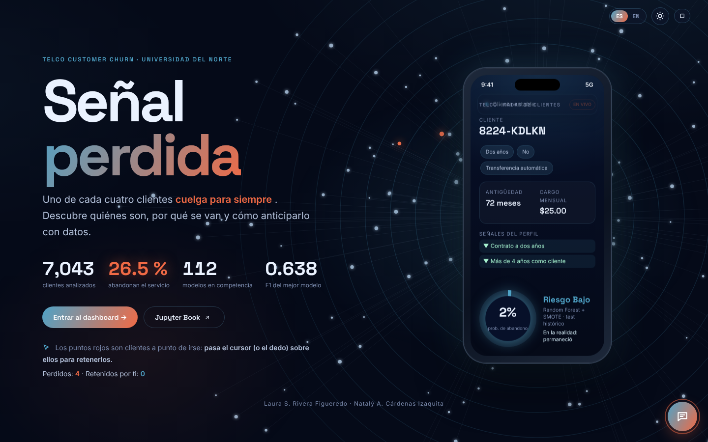

# Señal perdida · Dashboard Telco Customer Churn (Shiny)

Dashboard interactivo en **R Shiny y Plotly** para explorar el proyecto de abandono de clientes de **Laura Rivera y Natalý Cárdenas**, Universidad del Norte. Es la versión en R del dashboard [Dash_Telco_Churn](https://github.com/Nataly-Cardenas/Dash_Telco_Churn): mismas secciones, gráficas, textos, colores, animaciones, asistente e idiomas.



- Jupyter Book: https://nataly-cardenas.github.io/Telco_Churn_JBook/
- Fuente de los datos y resultados: https://github.com/Nataly-Cardenas/Telco_Churn_JBook
- Versión en Python (Dash): https://github.com/Nataly-Cardenas/Dash_Telco_Churn

## Ejecutar

Requiere R 4.1 o superior.

1. Instalar los paquetes (una sola vez), desde esta carpeta en la consola de R o RStudio:

   ```r
   source("install.R")
   ```

2. Ejecutar la aplicación:

   ```r
   shiny::runApp()
   ```

   En RStudio también se puede abrir `app.R` y pulsar **Run App**. Desde una terminal: `Rscript -e "shiny::runApp(port = 8050, launch.browser = TRUE)"`.

## Publicar en shinyapps.io

1. Crear una cuenta en https://www.shinyapps.io y copiar el token desde *Account → Tokens*.
2. En R:

   ```r
   install.packages("rsconnect")
   rsconnect::setAccountInfo(name = "<cuenta>", token = "<token>", secret = "<secreto>")
   rsconnect::deployApp()
   ```

La app no requiere base de datos ni acceso a GitHub al ejecutarse.

## Recorrido

Las secciones siguen los capítulos del Jupyter Book, con las mismas gráficas y tablas (animadas e interactivas), para poder explicar el proyecto desde el dashboard.

- **Portada interactiva:** una red de clientes conectados a un celular 3D. Los puntos resaltados son clientes a punto de irse y se pueden retener pasando el cursor (o el dedo).
- **Introducción:** contexto, objetivo general, objetivos específicos, marco teórico en tarjetas y descripción de variables.
- **Análisis exploratorio:** filtros globales y pestañas numeradas en el orden del dash: ETL y partición, univariado, bivariado (pruebas, Cramér V y Holm), multivariado (Q-Q, Spearman, matriz de dispersión, KDE), valores faltantes, resumen y explorador con descarga CSV.
- **Preprocesamiento:** pasos del pipeline, validación cruzada, ablación y evaluación del modelo base en test (matriz de confusión y ROC animada).
- **Modelado avanzado:** podio; resultados por modelo (matriz de confusión, ROC y confiabilidad), calibración, optimizadores, comparación estadística (Friedman, Nemenyi, DeLong) e interpretabilidad (SHAP global, waterfall y LIME).
- **Simulador:** herramienta creada para el dash (perfil de riesgo, clientes reales del test y laboratorio de umbral).
- **Conclusiones:** hallazgos, limitaciones, próximos pasos y enlace al paper.
- **Autoras:** fotos, LinkedIn, GitHub y correo.

Cada capítulo tiene un único enlace a su versión en el Jupyter Book, debajo del título. Las secciones usan fragmentos de URL (`#eda`, `#modelado`, etc.), así que admiten enlaces directos y los botones de atrás/adelante del navegador. El diseño se adapta a móvil y respeta `prefers-reduced-motion`.

## Idioma, tema y paleta

- **Español / inglés:** botones `ES | EN` arriba a la derecha. Las traducciones están en `data/i18n_en.json` y un test verifica que ningún texto quede sin traducir.
- **Modo claro / oscuro:** botón de sol/luna. La elección de idioma y tema se guarda en el navegador.
- **Íconos:** íconos de línea propios (`src/icons.R`), sin emojis.
- **Paleta:** las gráficas usan un solo color (`#2E86AB` azul) y cambian a `#E4572E` naranja solo para resaltar el mejor resultado o la clase de interés; `#9AA5B1` gris para referencias. El título de la portada y los botones llevan un degradado azul → naranja. Un test verifica que las gráficas no usen otros colores.

## Asistente

El botón flotante abre un asistente sin límite de preguntas que responde sobre el proyecto, sus datos y cada sección del dashboard, con su propia base de conocimiento (`data/faq.json`). Para preguntas sobre perfiles concretos, como «tasa de abandono de clientes con fibra y mes a mes», calcula la cifra sobre el conjunto de entrenamiento.

- **Sin configuración**, responde con la base de conocimiento local (búsqueda TF-IDF por n-gramas de caracteres, la misma del dashboard de Dash).
- **Con la variable de entorno `ANTHROPIC_API_KEY`**, redacta las respuestas con Claude (`claude-opus-5-5`) usando ese mismo contexto, y vuelve a la respuesta local si la API falla. Cada pregunta consume créditos de la API de Anthropic.

```r
Sys.setenv(ANTHROPIC_API_KEY = "tu-clave")
shiny::runApp()
```

En shinyapps.io la variable se define en un archivo `.Renviron` junto a `app.R` (no lo subas a GitHub).

## Contrato de datos

- Dataset real de 7.043 clientes, 1.869 abandonos.
- Índices históricos: 5.634 train y 1.409 test, sin solapamiento.
- `TotalCharges` se convierte a numérico para el EDA y conserva sus 11 ausencias. La explicación del pipeline documenta su imputación determinista con cero por `tenure = 0`.
- Los filtros superiores afectan al EDA y al explorador. **No recalculan ni reentrenan modelos publicados**.
- Las pruebas del EDA se recalculan en R con los mismos métodos del libro (chi-cuadrado, V de Cramér, Fisher, t de Welch, Mann–Whitney, punto-biserial, K² de D'Agostino, Holm, Spearman, KDE con ancho de Scott); los tests comprueban que coinciden con las cifras del libro.
- El simulador de perfil muestra la tasa de abandono **observada** en clientes de entrenamiento parecidos; no es una predicción del modelo.
- La tabla de 112 configuraciones representa media y desviación de cinco folds externos de la realización 0. `unidades.csv` contiene las 1.680 unidades (112 × 3 × 5).
- El laboratorio de umbral usa predicciones **nativas** guardadas de tres finalistas sobre el test histórico. Es didáctico: mover el umbral no valida una regla operativa.
- El test ya había sido expuesto en la primera entrega y es evidencia suplementaria. Los contrastes por folds son exploratorios, no confirmatorios.
- No se entrenan modelos al iniciar: predicciones OOF, SHAP y LIME vienen de los artefactos publicados.

## Archivos

- `app.R`: punto de entrada; carga los módulos de `src/` y crea la aplicación.
- `src/app_ui.R`, `src/app_server.R`: estructura de la página y lógica del servidor.
- `src/pages_eda.R`, `src/pages_model.R`, `src/pages_other.R`: portada y secciones con sus gráficas.
- `src/components.R`: paleta, tarjetas, KPIs, tablas, deslizadores, pestañas y estilo común de las gráficas.
- `src/analytics.R`, `src/eda.R`: datos, cohortes, ROC, umbral, clientes similares y pruebas estadísticas.
- `src/chatbot.R`: asistente (búsqueda, cálculo de perfiles y conexión opcional con Claude).
- `src/i18n.R`, `src/icons.R`: traducción e íconos.
- `www/style.css`, `www/shiny.css`: diseño visual, animaciones y estilos de los controles.
- `www/cover.js`: red de clientes, celular 3D y contadores animados; `www/app.js`: navegación, idioma, tema, pestañas, deslizadores, tablas y asistente.
- `data/`: CSV, interpretabilidad, traducciones y base del asistente, unos 11 MB.
- `tests/testthat/`: integridad del split, métricas, filtros, estadísticas del EDA, artefactos del modelado, colores, traducciones, asistente y que todas las páginas se generen en ES/EN.

## Verificar

```r
testthat::test_dir("tests/testthat")
```

Se comprobaron en Chromium la navegación, los filtros, las pestañas, los deslizadores, el asistente, la descarga CSV, el modo claro, el inglés y la vista móvil, comparando cada pantalla con la versión en Dash.
